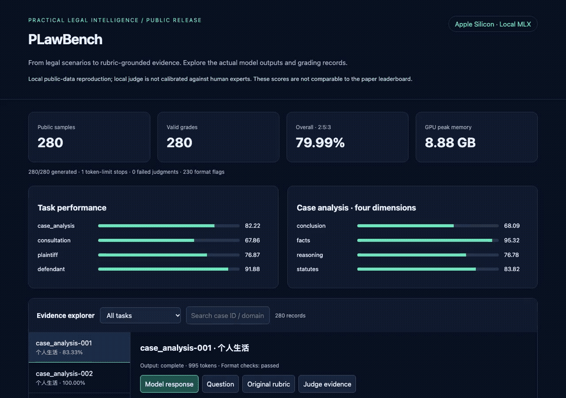
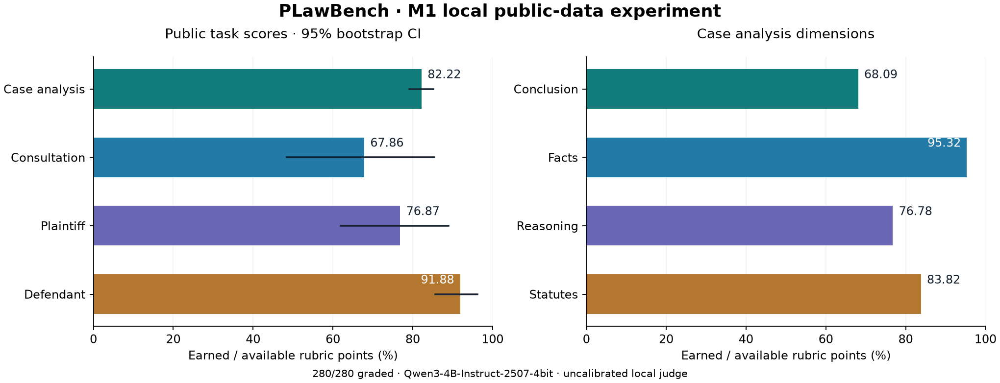
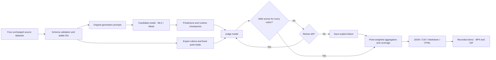
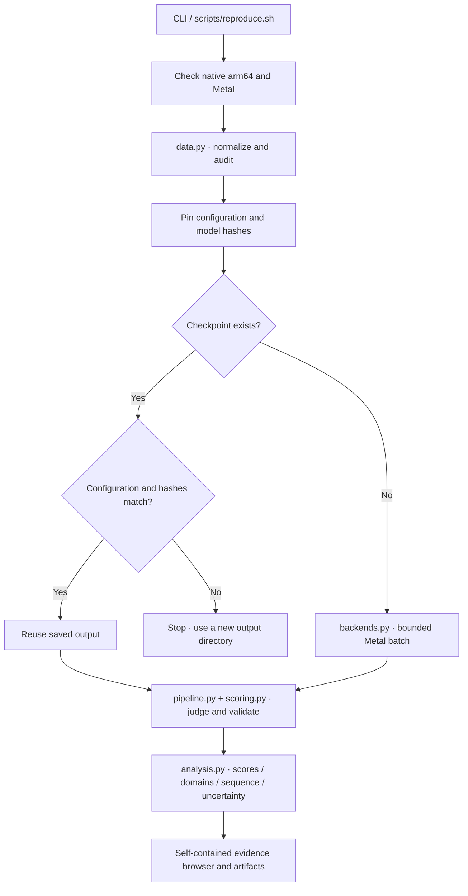

# PLawBench Local

[English](README.md) | [简体中文](README.zh-CN.md)

An Apple Silicon–optimized implementation of PLawBench for evaluating LLMs on 280 public Chinese legal scenarios, featuring local MLX inference, resumable rubric-based scoring, and interactive experiment reports.

The original Chinese legal scenarios, generation prompts and expert rubrics are preserved.

[Paper](https://aclanthology.org/2026.acl-long.458/) · [Reproduction scope](docs/REPRODUCTION.md) · [Experiment report](experiments/m1-public/REPORT.md) · [Original project README](docs/upstream/README.md)

## Demo

[](docs/assets/demo.mp4)

**The looping GIF above provides an automatic README preview when viewer motion settings allow it.** [Watch the MP4](docs/assets/demo.mp4) or open [the autoplay video page](docs/demo.html) locally with `open docs/demo.html`. The recording shows actual saved predictions, original rubrics and judge results.

<video src="docs/assets/demo.mp4" poster="docs/assets/demo-poster.png" autoplay loop muted playsinline controls width="960">
  <a href="docs/assets/demo.mp4">Watch the demo video</a>
</video>

GitHub [sanitizes README HTML](https://github.com/github/markup), so inline video autoplay cannot be guaranteed there. The GIF fallback respects [GitHub's animation preferences](https://docs.github.com/en/account-and-profile/how-tos/account-settings/managing-accessibility-settings). HTML renderers that permit video autoplay can play the muted MP4 inline. No external video hosting is required.

## What is preserved

PLawBench evaluates three stages of legal practice: eliciting missing facts in consultations, reasoning about cases, and drafting legal documents. The final ACL paper is the methodological reference. The original four data files remain byte-for-byte unchanged.

| Public subset | Questions | Evaluation |
|---|---:|---|
| Case analysis | 250 | Conclusion, facts, reasoning, statutes |
| Consultation | 18 | Expert question-specific point allocations |
| Plaintiff statements | 6 | Original drafting rubric and deductions |
| Defendant statements | 6 | Original drafting rubric and deductions |
| **Total** | **280** | Rubric-based LLM judging |

**Scope:** the paper describes 850 questions. Only these 280 are distributed here. The saved local experiment uses a quantized Qwen3-4B candidate and local Qwen3-4B judge, so it is a public-data reproduction with an uncalibrated self-judge, not a reproduction of the paper's Gemini-judged leaderboard. Human expert calibration and unavailable data are explicitly listed in the [coverage matrix](docs/REPRODUCTION.md). A [textual audit of main-run judgments](experiments/m1-public/judge_manual_audit.json) confirmed three citation attributions absent from the corresponding answers: local scores must be treated as diagnostics, not validated legal capability measurements.

The [run provenance](experiments/m1-public/normalization_migration.json) records a correction to duplicate rubric numbering in consultation-12. All 280 unchanged candidate responses and 279 unchanged judgments were verified and reused; the affected judgment was recomputed with unique IDs. Original rubric text, allocations and earlier attempts are preserved.

## Quick start on M1 / M2 / M3 / M4

Use native **arm64 Python 3.11**, **macOS 26 or newer**, and preferably **16 GB unified memory**. The pinned MLX/Metal wheels target macOS 26; older macOS releases and 8 GB configurations have not been validated. For limited memory, start with batch size 1. No CUDA, Docker, API key or paid service is required.

```bash
# If needed: brew install python@3.11
python3.11 -m venv .venv
source .venv/bin/activate
python -m pip install -e '.[metal,dev]'
plawbench doctor

# Four actual model generations + rubric judgments + report
plawbench run --per-task 1 --output experiments/my-smoke
open experiments/my-smoke/report.html
```

The first inference downloads the configured public MLX model. Subsequent runs can use `--offline`. The default candidate and judge are `mlx-community/Qwen3-4B-Instruct-2507-4bit`. Model revision, file hashes, package versions, seed, token limits and input hashes are retained in each run.

The exact environment used for the checked-in experiment is in [requirements-m1.lock.txt](requirements-m1.lock.txt). To reinstall it, use `python -m pip install -r requirements-m1.lock.txt` followed by `python -m pip install --no-build-isolation -e .`. The lock targets Python 3.11 on Apple Silicon.

## Reproduce all 280 public questions

```bash
source .venv/bin/activate
# Run under caffeinate to keep macOS awake. Use a new directory for your run.
PLAWBENCH_OUTPUT=experiments/my-public caffeinate -i sh scripts/reproduce.sh
# With model snapshots already cached:
PLAWBENCH_OUTPUT=experiments/my-public sh scripts/reproduce.sh --offline
```

This runs the full generation → judging → analysis pipeline. The [frozen configuration](configs/m1-public.json) uses a 16,384-token generation budget, generation batch size 4, judging batch size 2, seed 42 and pinned model revisions. Different candidate/judge models are loaded sequentially; an identical model is reused in memory. The MLX free cache is capped at 128 MiB and active allocations are monitored against a 6 GiB guideline; transient peaks can exceed it. Allow sufficient time for hundreds of local generations and judgments; the saved report records measured runtime.

View live progress without interrupting inference: `python scripts/progress.py experiments/my-public`.

Re-run the same command after interruption: finished records are reused. Changing model, dataset, selection, sampling or token settings requires a new output directory. A failed judgment remains a failure and never silently becomes a zero. Add `--retry-failed` to retry failed judgments with the same configuration.

To run each stage separately:

```bash
plawbench prepare --output experiments/staged
plawbench generate --output experiments/staged --batch-size 4 \
  --max-tokens 16384 --document-max-tokens 16384 \
  --model-revision 50d427756c6b1b2fe0c0a10f67fbda1fc8e82c1b
plawbench judge --output experiments/staged --batch-size 2 \
  --judge-revision 50d427756c6b1b2fe0c0a10f67fbda1fc8e82c1b
plawbench report --output experiments/staged
```

`--tasks case_analysis consultation plaintiff defendant` selects subsets; `--per-task N` selects the first N items of each requested subset. Use the same selection and `--consultation-level` on every stage. `--data-dir /path/to/data` or `PLAWBENCH_DATA` supports running outside the checkout. Run `plawbench --help` for all commands.

<!-- local-results:start -->
## Saved local result

**Local Qwen3-4B self-judge; uncalibrated diagnostic scores.**

| Subset | n | Score % |
|---|---:|---:|
| Consultation | 18 | 67.86 |
| Case analysis | 250 | 82.22 |
| Plaintiff statement | 6 | 76.87 |
| Defendant statement | 6 | 91.88 |

Overall (2:5:3): **79.99%**.

All 280 answers graded. [Read the findings and limitations](docs/EXPERIMENT_RESULTS.md).

Saved generation time: 185.98 minutes; all judge attempts: 357.05 minutes. Peak reported MLX allocation: 8.88 GB. Timings exclude model setup and unfinished interrupted batches.



<!-- local-results:end -->

## Data flow



Rubrics are supplied only to the judge. The original generation prompt includes a worked example that overlaps a released case; this inherited contamination risk is documented in [data quality notes](docs/DATA_QUALITY.md).

## Execution and project structure



```text
PLawBench/
├── *.json / *.jsonl          # Original public datasets, unchanged
├── src/plawbench/            # Loader, original prompts, MLX, scoring, CLI, analysis
├── configs/                 # Documented experiment configuration
├── scripts/                 # Full reproduction and demo recording
├── tests/                   # Data, scoring, resume, batching and statistics checks
├── experiments/             # Real outputs, raw judge attempts, manifests and reports
├── docs/                    # Reproduction scope, data audit, diagrams and media
│   └── upstream/            # Original README and scripts for provenance
├── prompt_generate.py       # Import-safe legacy prompt export entry point
└── prompt_zh.py             # Completed evaluator compatibility facade
```

## Scores, analysis and evidence

For each subset or case dimension, the scoring rate is `100 × Σ earned points / Σ dataset maximum points`. Drafting is the equal mean of the plaintiff and defendant subset rates, as reflected in Table 3; the pooled drafting rate is also saved separately. Overall follows final-paper Table 3: `0.2 × consultation + 0.5 × case analysis + 0.3 × drafting`. This is neither a simple average of question percentages nor a sample-count-weighted overall score.

Each completed run contains:

- `predictions/` and `predictions.jsonl`: actual responses, token counts, stop reasons and timing.
- `grades/` and `grades.jsonl`: raw judge attempts, validation errors, accepted scores and rationales.
- `generation_manifest.json`, `judge_manifest.json`, `dataset_manifest.json`: configuration, provenance and source hashes.
- `summary.json`, `scores.csv`, `REPORT.md`, `report.html`: coverage, task/dimension/domain results, explicit sequence groups and seeded bootstrap intervals.
- `samples.json`: exact normalized inputs and rubrics; the candidate receives only `messages`.

Sequence groups are conservatively inferred from explicit rubric wording, with ambiguous cases retained as `unspecified`. Their comparison is observational, not a causal ablation. Bootstrap intervals measure sampling variability conditional on the local judge; they do not validate its legal expertise. A rubric score is not an assurance of legal correctness.

Human-judge calibration is implemented but requires real annotations:

```bash
plawbench calibrate --human human-scores.jsonl --judge judge-scores.jsonl --output calibration.json
```

See [the annotation format](docs/REPRODUCTION.md#human-judge-calibration). No human scores are synthesized.

## Validation and troubleshooting

```bash
python -m pytest -q
python prompt_generate.py --output experiments/export/prompts.jsonl
```

- **Metal unavailable:** verify `uname -m` and `python -c 'import platform; print(platform.machine())'` both show `arm64`; avoid Rosetta Python.
- **Memory pressure:** start a new run with `--batch-size 1`. Do not run multiple model processes concurrently.
- **Offline model missing:** run once with network access, then use `--offline`. Models stay in the Hugging Face cache, outside Git.
- **Incomplete scoring:** inspect `grades/*.json`, then use the same judge command with `--retry-failed`. Missing/invalid scores are excluded, coverage is reported, and Overall is withheld until the selected run is complete.
- **Package download trouble:** retry your package index; the core loader, analysis and tests do not need MLX. `pip install --no-build-isolation -e .` works when build dependencies are already installed.

## Regenerate the figures and video

The checked-in media plays without dependencies. To record new results:

```bash
brew install ffmpeg
python -m pip install -e '.[demo]'
python -m playwright install chromium ffmpeg
python scripts/plot_results.py --run experiments/m1-public
make demo
```

The recorder drives the actual HTML report, verifies the interactions, records browser errors and saves a receipt alongside MP4, GIF and poster files. `make demo` also verifies the looping GIF and muted video autoplay in the local demo page under the browser’s default policy.

## Attribution

Original benchmark: Shi et al., [PLAWBENCH: A Rubric-Based Benchmark for Evaluating LLMs in Real-World Legal Practice](https://aclanthology.org/2026.acl-long.458/), ACL 2026, DOI `10.18653/v1/2026.acl-long.458`.

Inference uses [MLX LM](https://github.com/ml-explore/mlx-lm) and the [MLX Qwen3-4B model conversion](https://huggingface.co/mlx-community/Qwen3-4B-Instruct-2507-4bit). The [MIT license](LICENSE) covers this adaptation’s new code and documentation. The upstream checkout did not include a license file; the original data and code retain their upstream terms and are not relicensed here. Consult upstream authors and individual model licenses before redistribution.
