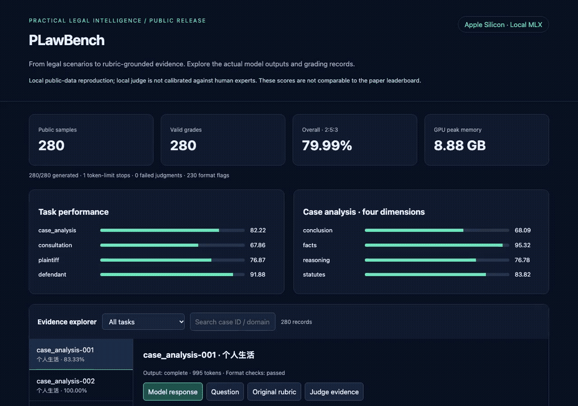
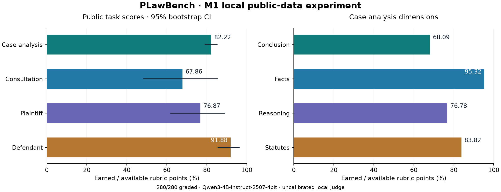
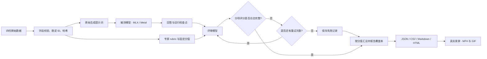
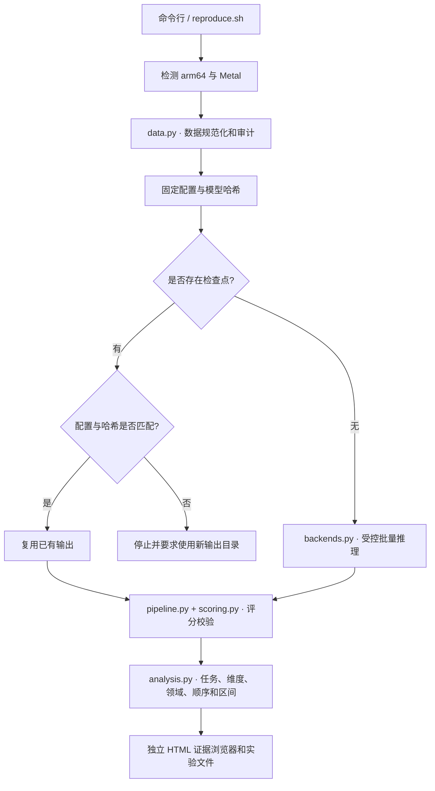

# PLawBench Local

[English](README.md) | [简体中文](README.zh-CN.md)

面向 Apple Silicon 优化的 PLawBench 本地实现，使用 280 个公开中文法律场景评估大语言模型，支持 MLX 本地推理、可恢复的 rubric 评分和交互式实验报告。

保留原始中文案例、生成提示词和专家评分标准。

[原始论文](https://aclanthology.org/2026.acl-long.458/) · [复现范围](docs/REPRODUCTION.md) · [实际实验报告](experiments/m1-public/REPORT.md) · [原项目 README](docs/upstream/README.md)

## 运行演示

[](docs/assets/demo.mp4)

**上方循环 GIF 在读者的动画偏好允许时自动播放。** [查看 MP4 视频](docs/assets/demo.mp4)，或用 `open docs/demo.html` 本地打开[自动播放页面](docs/demo.html)。演示录制自实际实验报告，可以查看模型回答、原始 rubric 和评分依据。

<video src="docs/assets/demo.mp4" poster="docs/assets/demo-poster.png" autoplay loop muted playsinline controls width="960">
  <a href="docs/assets/demo.mp4">查看演示视频</a>
</video>

GitHub 会[清理 README 中的 HTML](https://github.com/github/markup)，因此不能保证内嵌视频自动播放。GIF 提供自动预览，同时遵守[读者的动画偏好](https://docs.github.com/en/account-and-profile/how-tos/account-settings/managing-accessibility-settings)。允许视频自动播放的 HTML 渲染器可以播放静音 MP4。视频文件保存在项目中，无需第三方托管。

## 保留的核心思想与功能

保留“法律咨询 → 案例分析 → 法律文书生成”三个法律实践环节，以及基于专家 rubric 的细粒度评分。方法以 ACL 最终版论文为准，四份原始数据文件保持逐字节不变。

| 公开任务 | 题数 | 评分方式 |
|---|---:|---|
| 案例分析 | 250 | 结论、案件事实、推理过程、法条依据 |
| 法律咨询 | 18 | 按专家列出的追问要点逐项计分 |
| 起诉状 | 6 | 原始文书 rubric 及扣分规则 |
| 答辩状 | 6 | 原始文书 rubric 及扣分规则 |
| **合计** | **280** | 基于 rubric 的模型评分 |

**复现边界：**论文包含 850 题，本仓库仅公开 280 题。保存的全量本地实验使用量化 Qwen3-4B 作为被测模型和评审模型，属于未经专家校准的本地自评分实验，不能等同于论文使用 Gemini 评审的排行榜。未公开数据、专家校准和原始多模型实验的限制详见[覆盖矩阵](docs/REPRODUCTION.md)。[正式实验的文本审计](experiments/m1-public/judge_manual_audit.json)确认了三处评审器声称答案引用条文、但原答案中并未出现的情况，因此本地分数只能作为诊断结果，不能当作经过验证的法律能力测量。

[实验来源记录](experiments/m1-public/normalization_migration.json)记载了咨询第 12 题的评分编号修复：核对并复用了输入未变的 280 条回答和 279 条评分，仅用唯一 ID 重新评估受影响的一题。原始评分文字、分值和之前的尝试均已保留。

## M1 / M2 / M3 / M4 快速开始

使用原生 **arm64 Python 3.11** 和 **macOS 26 或更新版本**，建议 **16 GB 统一内存**。锁定的 MLX/Metal 安装包以 macOS 26 为最低系统版本；旧版 macOS 和 8 GB 机器尚未实测。内存较小时请从 batch size 1 开始。无需 CUDA、Docker、API 密钥或付费服务。

```bash
# 如未安装：brew install python@3.11
python3.11 -m venv .venv
source .venv/bin/activate
python -m pip install -e '.[metal,dev]'
plawbench doctor

# 四类任务各一题：真实生成、评分、分析
plawbench run --per-task 1 --output experiments/my-smoke
open experiments/my-smoke/report.html
```

首次推理会下载公开 MLX 模型，已有缓存时可添加 `--offline`。默认被测模型和评审模型均为 `mlx-community/Qwen3-4B-Instruct-2507-4bit`。每次实验保存模型版本、文件哈希、依赖版本、随机种子、长度限制和输入哈希。

实测依赖版本见 [requirements-m1.lock.txt](requirements-m1.lock.txt)。精确重建可先运行 `python -m pip install -r requirements-m1.lock.txt`，再运行 `python -m pip install --no-build-isolation -e .`。该锁定文件适用于 Apple Silicon / Python 3.11。

## 复现全部 280 题

```bash
source .venv/bin/activate
# caffeinate 防止系统睡眠；请使用新目录保存自己的实验
PLAWBENCH_OUTPUT=experiments/my-public caffeinate -i sh scripts/reproduce.sh
# 模型已经缓存时：
PLAWBENCH_OUTPUT=experiments/my-public sh scripts/reproduce.sh --offline
```

脚本依次执行生成、评分和分析。[实验配置](configs/m1-public.json)使用 16,384 token 生成上限、生成 batch size 4、评分 batch size 2、种子 42 和固定模型版本。不同模型分阶段加载；相同模型复用一个实例。MLX 空闲缓存限制为 128 MiB，活动分配按 6 GiB 参考预算监测，瞬时峰值可能超过该值。完整实验涉及数百次生成与评分，实际运行耗时保存在报告中。

使用 `python scripts/progress.py experiments/my-public` 可查看实时检查点进度，不会中断模型。

中断后重新执行相同命令即可复用已完成记录。模型、数据、题目选择、采样参数或长度上限发生变化时，必须使用新输出目录。评分失败会显式记录，不会伪装成零分；添加 `--retry-failed` 可重试失败项。

也可逐步运行：

```bash
plawbench prepare --output experiments/staged
plawbench generate --output experiments/staged --batch-size 4 \
  --max-tokens 16384 --document-max-tokens 16384 \
  --model-revision 50d427756c6b1b2fe0c0a10f67fbda1fc8e82c1b
plawbench judge --output experiments/staged --batch-size 2 \
  --judge-revision 50d427756c6b1b2fe0c0a10f67fbda1fc8e82c1b
plawbench report --output experiments/staged
```

`--tasks` 可选择 `case_analysis consultation plaintiff defendant`；`--per-task N` 选择各子集前 N 题。各阶段需使用相同的题目选择和 `--consultation-level`。可通过 `--data-dir /path/to/data` 或 `PLAWBENCH_DATA` 指定数据路径，在项目目录外运行。完整选项见 `plawbench --help`。

<!-- local-results:start -->
## 已保存的本地实验结果

**Qwen3-4B 本地自评分，以下分数未经专家校准，仅用于诊断。**

| 子集 | 题数 | 得分率 % |
|---|---:|---:|
| 法律咨询 | 18 | 67.86 |
| 案例分析 | 250 | 82.22 |
| 起诉状 | 6 | 76.87 |
| 答辩状 | 6 | 91.88 |

总分（2:5:3）: **79.99%**.

280 题均已完成评分。[查看分析结论与限制](docs/EXPERIMENT_RESULTS.md)。

已保存的生成耗时：185.98 分钟；全部评分尝试耗时：357.05 分钟。记录的 MLX 分配峰值：8.88 GB。耗时不含模型准备及中断时未完成的批次。



<!-- local-results:end -->

## 数据流图



每题 rubric 只提供给评审模型。原始生成提示词的示例与公开数据中的一题存在重叠，这一继承的污染风险记录在[数据质量说明](docs/DATA_QUALITY.md)中。

## 结构与执行流程图



```text
PLawBench/
├── *.json / *.jsonl          # 保留的四份原始公开数据
├── src/plawbench/            # 数据、原始提示词、MLX、评分、CLI、分析
├── configs/                 # 实验配置
├── scripts/                 # 完整复现和演示录制
├── tests/                   # 数据、分值、恢复、批处理和统计测试
├── experiments/             # 真实输出、原始评分、运行清单和报告
├── docs/                    # 复现说明、数据审计、流程图和视频
│   └── upstream/            # 原始 README 与脚本快照
├── prompt_generate.py       # 可安全导入的兼容提示词导出入口
└── prompt_zh.py             # 已实现的评分器兼容入口
```

## 指标与分析文件

各子集及案例维度得分率使用 `100 × Σ实际得分 / Σ数据集满分`。文书任务取起诉状与答辩状子集得分率的等权平均，与表 3 的数值关系一致；程序另外保留合并分值口径用于核对。按照论文最终版表 3，总分为 `0.2 × 咨询 + 0.5 × 案例分析 + 0.3 × 文书生成`，不使用逐题百分比简单平均，也不按题目数量加权总分。

每次完整运行保存：

- `predictions/` 和 `predictions.jsonl`：回答、token 数、停止原因和耗时。
- `grades/` 和 `grades.jsonl`：每次原始评审输出、校验错误、最终分值和理由。
- 三份 `*_manifest.json`：生成、评分、数据版本与文件哈希。
- `summary.json`、`scores.csv`、`REPORT.md`、`report.html`：覆盖率、任务/维度/领域结果、显式顺序分组、bootstrap 区间。
- `samples.json`：规范化输入与 rubric；被测模型只接收其中的 `messages`。

顺序分组依据 rubric 的明确约束，无法确定的题目保留为 `unspecified`；分组差异不是因果消融结论。Bootstrap 区间仅表示给定本地评审器下的抽样变动，不能证明评审器的法律准确性。高 rubric 得分也不等于法律结论正确。

专家评分校准功能已经实现，但需提供真实标注：

```bash
plawbench calibrate --human human-scores.jsonl --judge judge-scores.jsonl --output calibration.json
```

输入格式见[校准说明](docs/REPRODUCTION.md#human-judge-calibration)。项目不会合成人工评分作为实验结果。

## 验证与常见问题

```bash
python -m pytest -q
python prompt_generate.py --output experiments/export/prompts.jsonl
```

- **Metal 不可用：**确认 `uname -m` 与 Python 的 `platform.machine()` 都是 `arm64`，避免 Rosetta 环境。
- **内存不足：**新建实验目录，使用 `--batch-size 1`；避免同时运行多个模型进程。
- **离线缓存缺失：**先联网运行一次，再使用 `--offline`。权重保存在 Hugging Face 缓存，不写入 Git。
- **评分不完整：**查看 `grades/*.json`，使用相同评分参数添加 `--retry-failed`。程序报告缺失覆盖率，并在未完整评分时不发布总分。
- **安装网络问题：**重试软件源；已具备构建依赖时可使用 `pip install --no-build-isolation -e .`。数据加载、分析和单元测试不依赖 MLX。

## 重新生成图表和视频

现有演示无需安装依赖即可播放。如需录制新的结果：

```bash
brew install ffmpeg
python -m pip install -e '.[demo]'
python -m playwright install chromium ffmpeg
python scripts/plot_results.py --run experiments/m1-public
make demo
```

录制脚本实际操作 HTML 报告，验证交互、记录浏览器错误，并同时保存 MP4、GIF、封面及录制回执。`make demo` 还会验证 GIF 循环，以及本地演示页面在浏览器默认策略下的静音视频自动播放。

## 引用与许可

原始工作：Shi et al., [PLAWBENCH: A Rubric-Based Benchmark for Evaluating LLMs in Real-World Legal Practice](https://aclanthology.org/2026.acl-long.458/), ACL 2026，DOI：`10.18653/v1/2026.acl-long.458`。

本地推理基于 [MLX LM](https://github.com/ml-explore/mlx-lm) 与 [MLX Qwen3-4B 转换模型](https://huggingface.co/mlx-community/Qwen3-4B-Instruct-2507-4bit)。本次改造新增的代码和文档采用 [MIT 许可](LICENSE)。原始仓库未附许可文件，原始代码和数据仍遵循上游条款，不在此重新授权；再分发时请核实原作者与各模型的许可条款。
